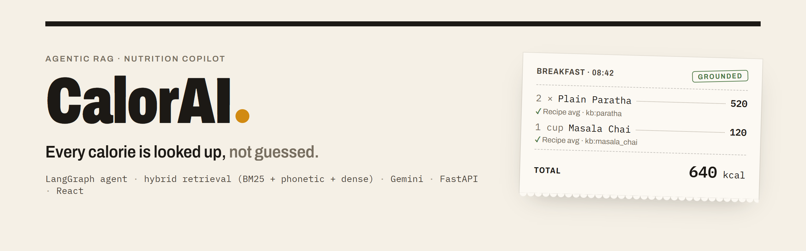
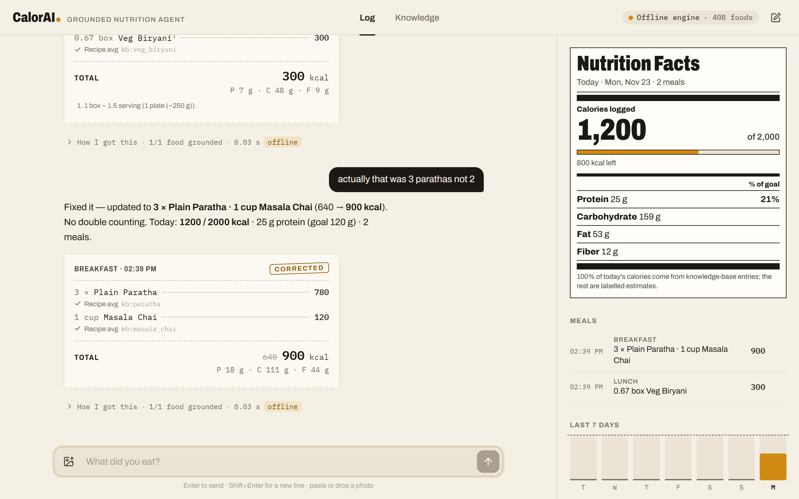
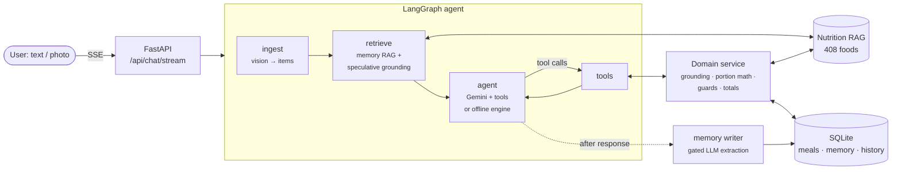
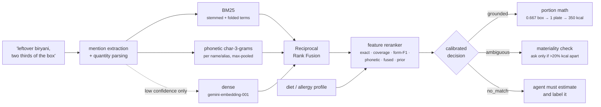
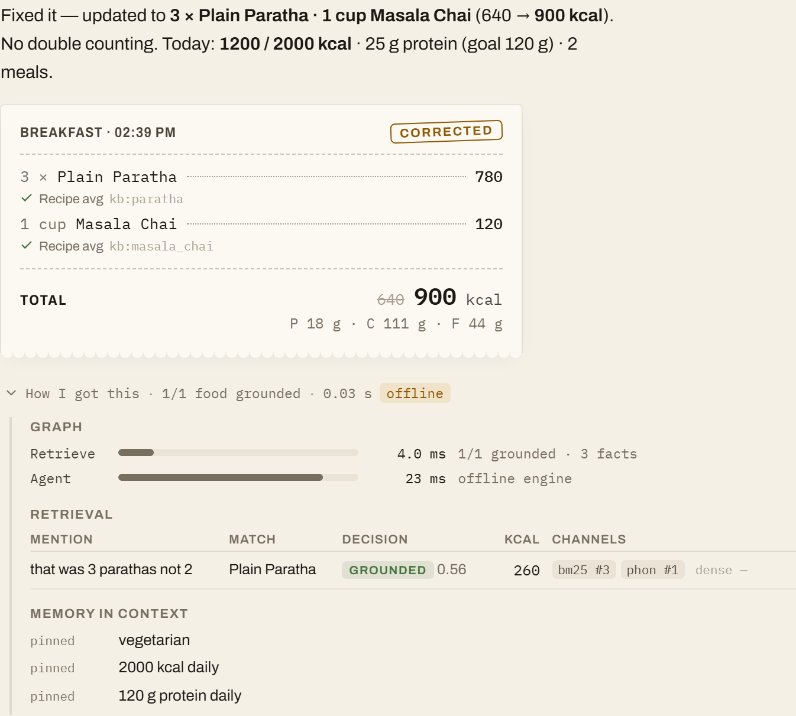
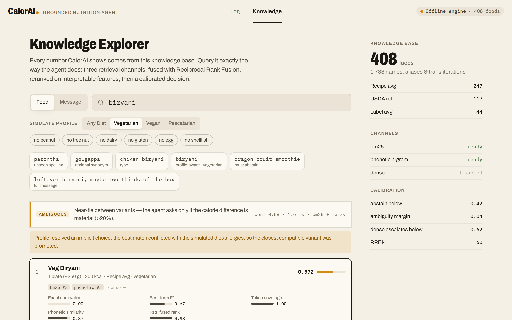
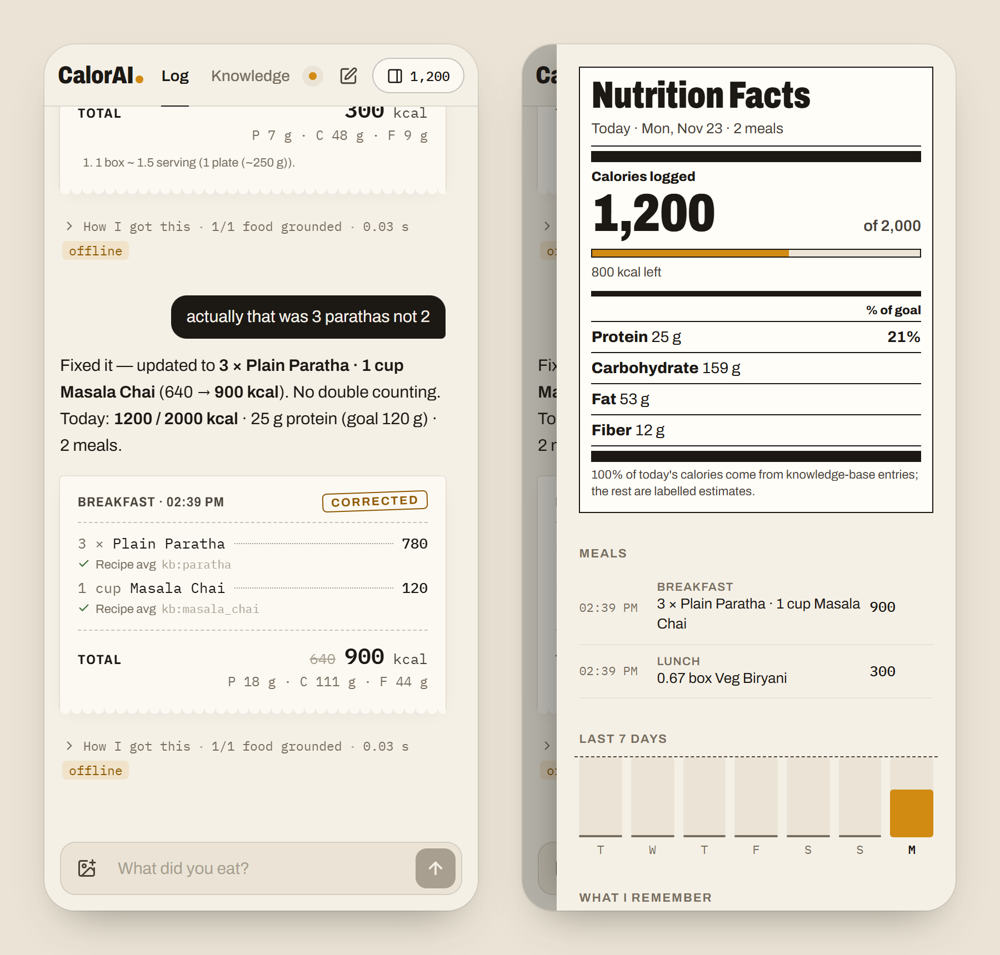

<p align="center">
  
</p>

<p align="center">
  <a href="https://github.com/rafrafreza/CalorAI-Agentic-RAG/actions/workflows/ci.yml"></a>
  
  
  
  
  
</p>

**CalorAI is a conversational nutrition agent whose numbers are grounded, not guessed.** You text it the way you'd text a friend — *"had 2 parathas and chai"*, *"leftover biryani, maybe two thirds of the box"*, *"actually that was 3 rotis not 2"*, or a photo of your plate — and it logs the meal with calories pulled from a curated nutrition knowledge base through a hybrid retrieval pipeline. Every line item carries its source; anything not in the knowledge base is labelled as an estimate.

It started as the **CalorAI take-home challenge** (a conversational meal-logging agent with memory, vision and correction handling). v2 rebuilds it around the problem that actually matters for an AI calorie tracker: **LLMs hallucinate nutrition numbers and can't do arithmetic.**

<p align="center"></p>

---

## Contents

- [Highlights](#highlights)
- [Architecture](#architecture)
- [The RAG engine](#the-rag-engine)
- [Evaluation](#evaluation)
- [The agent](#the-agent)
- [Product & UI](#product--ui)
- [Quick start](#quick-start)
- [API](#api)
- [Engineering decisions](#engineering-decisions)
- [Project structure](#project-structure)
- [v1 → v2](#v1--v2)
- [Roadmap](#roadmap)

## Highlights

| | |
|---|---|
| 🔎 **Hybrid retrieval, built from first principles** | BM25 + a *phonetic* character-n-gram channel (handles `parontha`, `chhole`, `biriyaani`) + optional Gemini embeddings, fused with Reciprocal Rank Fusion and reranked on interpretable features. ~2 ms per query, no vector DB needed. |
| 🎯 **Calibrated decisions, not just top-k** | Every lookup ends in `grounded`, `ambiguous` or `no_match`. Out-of-knowledge-base foods **abstain** (93.8% on held-out queries) so the agent estimates *and says so* instead of passing off "banana smoothie" as "dragon fruit smoothie". |
| 🧮 **The LLM proposes, the engine disposes** | The model decides *what* you ate; deterministic code scales portions (`two thirds of the box`, `200 g`, `10 almonds`) and sums macros. Corrections replace a meal in place — double counting is structurally impossible. |
| 🥗 **Profile-aware RAG** | Memory shapes retrieval: a vegetarian saying *"biryani"* gets **Veg Biryani**; *"chicken biryani"* is respected but flagged. Allergens are surfaced on every match. |
| ⚡ **Speculative retrieval** | Food mentions are grounded *before* the LLM runs and injected as context, so the agent usually logs in one tool round instead of lookup → log → reply. Dense embeddings are only called when the cheap channels are unsure. |
| 📏 **Measured, not vibes** | 221 labelled retrieval queries, dev/test split, ablation table, and a **CI quality gate** that fails the build if held-out quality regresses. |
| 🧪 **126 offline tests** | A scripted chat model drives the *real* LangGraph agent through tool calls, corrections, SSE streaming and provider outages — in CI, with no API key. |
| 🛟 **Graceful degradation** | No key, or Gemini down? A deterministic offline engine on the same RAG stack keeps logging, corrections, goals and totals working. |
| 🧾 **A UI that shows its work** | Meals print as itemised *nutrition receipts* with per-line provenance; a live Nutrition Facts panel; a "How I got this" trace per reply; and a Knowledge Explorer to interrogate the retriever. |

## Architecture



One chat turn:

1. **ingest** — if there's a photo, a separate vision call returns structured items (it never converses or produces calories). Photo + caption become *one* turn, so *"half of this was my brother's"* adjusts portions instead of logging twice.
2. **retrieve** — loads memory (safety-critical facts are **pinned**, the long tail is retrieved), builds the diet/allergy profile, extracts food mentions and grounds them through the RAG engine.
3. **agent** — Gemini with 10 tools sees the grounded context (KB ids, scaled macros, ambiguity, conflicts) and decides: log, ask, correct or answer. Without a key, the deterministic offline engine handles the turn.
4. **tools** — thin adapters over the domain service, which re-grounds every item, does the math, applies duplicate/typo guards and returns running totals.
5. **stream** — node steps, retrieval results, tool calls, meal changes and tokens stream to the UI as Server-Sent Events; memory extraction runs *after* the response.

## The RAG engine

`backend/rag/` — dependency-light (pure Python + numpy), fully unit-tested, and explainable down to each feature.



**Knowledge base.** [`foods.csv`](backend/rag/data/foods.csv) — 408 foods (South Asian depth plus global staples), 1,783 names, aliases and transliterations, per-serving macros, gram weights, diet class, allergens and a **provenance tag on every row** (`usda-ref`, `recipe-avg`, `label-avg`). The KB is tested like code: Atwater energy consistency for every row, enum validity, no alias pointing at two foods, and **self-retrieval** — every one of the 408 foods must come back first when searched by its own name.

**Text views.** Two complementary views of every string: an *orthographic* one (normalised, stemmed) and a *phonetic* one that folds the many ways South Asian dishes are romanised (`dhal/daal/dal`, `chhole/chole`, `keema/qeema`, `idly/idli`). Token similarity takes the best of both views — folding helps transliterations but can hurt English typos (`oatmeel` folds towards `oatmilk`), so each view covers the other's blind spot.

**Channels & fusion.** BM25 catches lexical evidence and English glosses (*"lentil curry"*); the phonetic n-gram channel indexes each name/alias separately and max-pools per food so one strong alias isn't diluted; the dense channel (optional) catches paraphrase. RRF combines ranks, so no cross-channel score calibration is needed.

**Reranking & decisions.** Interpretable features, all in `[0, 1]`: exact surface-form match, soft token coverage, best-form F1 (penalises extra qualifiers — *"biryani"* vs *"chicken biryani"*), phonetic similarity, fused rank and a small popularity prior. A **coverage penalty** stops partial explanations from grounding (*"dragon fruit smoothie"* ≠ *"banana smoothie"*). The top score vs calibrated thresholds yields the decision; near-ties are `ambiguous`, and a **materiality check** decides whether the difference is worth a clarifying question.

**Profile-aware disambiguation.** If the best match conflicts with the user's diet or allergies *and the user didn't name the conflicting ingredient*, the closest compatible variant within a margin is promoted (preferring the closest diet: Veg before Egg Biryani for a vegetarian). Explicit requests are never overridden — conflicts are attached instead.

**Adaptive dense escalation.** The embedding call costs a network round trip, so it only runs when lexical confidence is below a threshold; corpus vectors are cached on disk keyed by model + KB fingerprint, built in a background thread, and the system silently runs lexical-only if they're unavailable.

**Quantities & portions.** `parse_quantity` handles numbers, fractions (`1 1/2`, `½`, `two thirds`), number words, units and containers; `portion.py` converts to grams with explicit, user-visible assumptions (`1 box ≈ 1.5 servings`, `~1 g/ml`) and per-piece weights so *"10 almonds"* is 12 g, not ten 28 g servings.

## Evaluation

`python -m evals.retrieval_eval` — 221 labelled queries across 10 categories, including 29 out-of-KB queries that must abstain. Deterministic 50/50 dev/test split by query hash; reranker weights and thresholds were tuned on **dev only**. Numbers below are the **held-out test split**, lexical stack (no API key), reproduced in every CI run:

| Configuration | Hit@1 | Hit@3 | MRR@10 | Hit@1 on unseen spellings |
|---|---:|---:|---:|---:|
| BM25 only | 76.0% | 85.6% | 0.817 | 35.5% |
| Phonetic fuzzy only | 82.7% | 96.2% | 0.892 | 48.4% |
| BM25 + fuzzy (RRF) | 87.5% | 96.2% | 0.920 | 67.7% |
| **Hybrid + reranker (full)** | **95.2%** | **96.2%** | **0.961** | **83.9%** |

| Decision metric (full system) | Value |
|---|---:|
| Grounding accuracy (right food, not abstained) | 94.2% |
| Correct abstention on out-of-KB queries | 93.8% |
| False-grounding rate on out-of-KB queries | 6.2% |
| Latency p50 / p95 per query (CPU) | ~2 ms / ~4 ms |

Per category: canonical, compound dishes, morphology, profile-conditioned and transliteration queries are at 100%; synonyms 95.8%, typos 94.1%. **Descriptive paraphrases** (*"fermented rice crepe"* → dosa) are the lexical stack's honest weak spot at 20% — exactly the gap the dense channel is designed to close (`make eval-dense` with a key). "Unseen spellings" are queries whose spelling is *not* in the alias table, i.e. the retriever had to generalise.

The CI quality gate fails the build if held-out Hit@1 drops below 85%, grounding accuracy below 80% or correct abstention below 80%.

**Agent behaviour** is covered by tests that run the real graph with a scripted model: grounded logging with KB ids in the prompt, in-place corrections (totals 300, not 200 + 300), confirmation relay for implausible amounts, provider outage → offline engine, the tool-loop cap, SSE token streaming, and conversion of every tool schema to a Gemini function declaration.

## The agent

**Tools** — ten, with non-overlapping responsibilities; the acting user always comes from the run config, never from the model:

| Tool | Type | Notes |
|---|---|---|
| `lookup_nutrition` | READ | RAG grounding of one food: KB id, scaled macros, alternatives, conflicts |
| `log_meal` | CREATE | One call per meal. Server grounds items and computes totals; KB values beat model guesses |
| `update_meal` | UPDATE | Full corrected item list; description regenerated — never stale |
| `delete_meal` | DELETE | Soft delete; ownership-checked |
| `get_meals` / `search_meal_history` | READ | By date / fuzzy search over your own meals (*"that paneer wrap"*) |
| `get_daily_totals` | READ | Totals + goals from memory + remaining |
| `get_user_memory` / `set_user_memory` / `delete_user_memory` | MEMORY | Durable facts, user-erasable |

**Guards that used to be prompt rules are now code.** v1 asked the model to recompute macros on corrections, rewrite descriptions, and question duplicates or "50 parathas". v2 enforces all of it: totals are summed server-side, descriptions are generated from items, and `log_meal` returns `needs_confirmation` for identical meals within 3 minutes or implausible amounts until the user confirms.

**Memory.** Write path: after the response is sent, a cheap lexical gate skips turns that can't contain durable facts (most are plain food logs); otherwise a structured-output LLM call extracts facts, reusing existing keys to avoid near-duplicates. Read path: `preference` and `target` facts are **always pinned** (an allergy must never fall out of context because a message wasn't semantically similar — a v1 failure mode); shortcuts and personal context are retrieved by hybrid similarity, and cues like *"my usual"* pull in shortcuts. Memory is visible and deletable in the UI.

**Resilience.** If the LLM fails before any tool has run, the turn is re-handled by the offline engine; if it fails mid-turn, the user is told which actions completed. A tool-round cap and LangGraph's recursion limit prevent loops.

## Product & UI

React 19 + TypeScript + Vite; no UI kit — a small, deliberate design system ("kitchen ledger": receipt paper, carbon ink, nutrition-label rules, one turmeric accent; Archivo variable width + IBM Plex Mono).

- **Nutrition receipts** — each logged, corrected or removed meal prints as an itemised receipt: quantity, food, kcal, provenance (`✓ Recipe avg · kb:paratha` or `≈ Model estimate`), footnoted assumptions, and the old total struck through on corrections.
- **Nutrition Facts panel** — today's totals as a live label with goal progress, % of goals, meals (deletable), a 7-day strip and the memory that's shaping retrieval.
- **"How I got this"** — every reply expands into graph-node timings, retrieval decisions with per-channel ranks, and the memory facts that were in context.
- **Knowledge Explorer** — query the retriever as the agent does, simulate a diet/allergy profile, and see ranks, feature bars, conflicts and the calibrated decision.

| Glass-box trace | Knowledge Explorer |
|---|---|
|  |  |

<p align="center"></p>

<sub>Screenshots are of the real app running on the offline engine (no API key).</sub>

## Quick start

**Docker (one container, API + web app):**

```bash
git clone https://github.com/rafrafreza/CalorAI-Agentic-RAG.git && cd CalorAI-Agentic-RAG
cp .env.example .env          # optional: add GOOGLE_API_KEY for the full Gemini agent
docker compose up --build     # → http://localhost:8000
```

**Local development:**

```bash
pip install -r requirements-dev.txt
uvicorn backend.main:app --reload --port 8000      # API + docs at /docs

cd frontend && npm ci && npm run dev               # → http://localhost:3000
```

Without `GOOGLE_API_KEY` everything runs on the offline engine — try *"had 2 parathas and chai"*, *"actually that was 3 parathas not 2"*, *"I'm vegetarian"*, *"how am I doing?"*. With a key you get the Gemini agent, photo analysis, LLM memory extraction and the dense channel.

```bash
make test         # 126 tests, fully offline
make eval         # retrieval ablations on the held-out split
make lint         # ruff + tsc
```

## API

| Method | Path | Purpose |
|---|---|---|
| `POST` | `/api/chat/stream` | Multipart (`message`, `session_id`, optional `image`) → SSE: `start`, `step`, `vision`, `retrieval`, `tool_call`, `tool_result`, `meal`, `token`, `done` |
| `POST` | `/api/chat` | Same turn, single JSON response |
| `GET` | `/api/dashboard` | Day totals, goals, meals, 7-day trend, memory, profile, grounded share |
| `GET` · `DELETE` | `/api/meals`, `/api/meals/{id}` | List / delete meals |
| `GET` · `DELETE` | `/api/memory`, `/api/memory/{key}` | Inspect / forget facts |
| `GET` | `/api/rag/search?q=&diet=&allergens=` | Ranked candidates with channel ranks, features, decision |
| `GET` | `/api/rag/analyze?text=` | Mention extraction + grounding for a whole message |
| `GET` | `/api/rag/stats` | KB size, channel status, calibrated thresholds |
| `GET` | `/health`, `/metrics` | Status; rolling p50/p95/p99 per chat path and per graph node |

```bash
curl -s -X POST localhost:8000/api/chat -F "message=leftover biryani, maybe two thirds of the box"
curl -s "localhost:8000/api/rag/search?q=biryani&diet=vegetarian" | jq '.candidates[0].name'   # "Veg Biryani"
```

## Engineering decisions

| Decision | Why |
|---|---|
| **Hand-built hybrid retriever instead of a vector DB** | ~400 docs fit in memory; the hard part is *transliteration and abstention*, not ANN search. A transparent pipeline makes every ranking explainable and testable, and runs in CI without keys. |
| **RRF + interpretable reranker** | No score calibration across BM25 / cosine / embeddings; features double as the UI's explanation. |
| **Abstention as a first-class outcome** | A confidently wrong grounding is worse than an honest estimate. Measured explicitly (false-grounding rate). |
| **Server-side arithmetic, generated descriptions** | Removes a whole class of LLM errors that v1 patched with prompt rules. |
| **Speculative retrieval before the LLM** | Saves a tool round per logging turn; the agent still has `lookup_nutrition` for anything missed. |
| **Pinned vs retrieved memory** | Safety-critical facts must never depend on similarity thresholds. |
| **Totals via SUM, never materialised** (kept from v1) | Single source of truth — corrections can't leave totals stale. |
| **SQLite + WAL** | Zero-ops for a single-node app; the schema migrates additively from v1 databases. |
| **Offline engine** | Resilience to provider outages, zero-key try-out, and real end-to-end tests in CI. |
| **Same provider for chat and vision, separated by role** | Vision only emits structured items; its items are grounded through the same RAG path as text, so a photo of biryani and the word "biryani" get the same numbers. |

**Honest limits.** KB values are reference approximations, not medical-grade data. The LLM-path latency depends on Gemini and is reported live at `/metrics` rather than claimed here (v1 measured ~1.6 s responses on `gemini-3.1-flash-lite`). Single-user by default (`user_id` is plumbed through every layer but there is no auth).

## Project structure

```
backend/
  rag/            corpus · text views · BM25 & phonetic indexes · dense · retriever · quantity · portion · profile · mentions · service
  agent/          LangGraph graph · nodes · tools · prompts · offline engine · memory writer
  services/       nutrition_log — grounding, portion math, guards, goals (shared by tools, offline engine, API)
  api/            chat (SSE) · data · rag · uploads
  db/             SQLite schema, meals, memory & history
  core/           settings · model factory · telemetry
  vision/         photo → structured items
evals/            retrieval eval harness + labelled dataset
tests/            126 offline tests (scripted LLM, API, RAG, KB quality, eval gate)
frontend/         React + TypeScript UI
```

## v1 → v2

| | v1 (challenge submission) | v2 |
|---|---|---|
| Nutrition data | 50-item hard-coded dict, exact-key lookup | 408-food KB with provenance, hybrid retrieval, abstention |
| Macro arithmetic | LLM adds numbers | Server-side, deterministic |
| Corrections | Prompt rules to recompute | `update_meal` replaces items; totals & description recomputed |
| Duplicates / typos | Prompt instructions | Structural `needs_confirmation` |
| Memory retrieval | Embedding similarity for everything | Pinned safety facts + hybrid retrieval; erasable in UI |
| Responses | Blocking request | SSE streaming with live steps |
| Without an API key | Unusable | Offline engine on the same RAG stack |
| Tests | 15 | 126, incl. the real agent with a scripted LLM, plus an eval gate |
| UI | Single chat column | Receipts, Nutrition Facts panel, trace, Knowledge Explorer |

v1's public LangSmith traces of the original agent: [logging](https://smith.langchain.com/public/87e028b4-b9ae-4ba7-ab48-d1a134e70d54/r/01a0661c-a70b-7ff0-a305-9ad6fb7061c3) · [setting memory](https://smith.langchain.com/public/66f54d6d-bfb9-4bb0-b38d-664f68d15508/r/01a0661e-d403-7a71-be02-8693715e0c76) · [recalling memory](https://smith.langchain.com/public/14ad6d07-44cd-4c78-9a8f-020d43e5bafc/r/01a0661f-a966-7933-b583-2e4e77b14f02) · [photo logging](https://smith.langchain.com/public/ed2110d3-b8ae-4fbe-823f-1a508a46bfd5/r/01a06620-b524-76e2-98e0-99aad7472573). LangSmith tracing still works in v2 via the `LANGSMITH_*` env vars.

## Roadmap

- Run and publish the dense-channel ablation (`make eval-dense`), focused on descriptive queries.
- Expand the KB from public USDA FoodData Central exports for long-tail coverage, keeping curated South Asian entries first.
- An LLM-judged agent eval set (ask-vs-log, correction, photo+caption) with trajectory assertions on the live model.
- Auth + Postgres/pgvector for multi-user deployment.

## AI-assisted development

Built with AI pair-programming (Claude Code), in line with the original challenge's encouragement of AI tools. Every claim in this README is backed by code in the repo and by checks that run in CI.

---

<sub>Built by [Rafraf Reza](https://github.com/rafrafreza). Nutrition values are approximate references for a consumer logging app — not medical advice.</sub>
